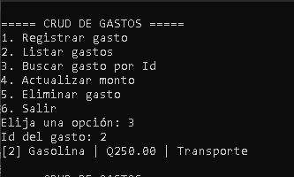
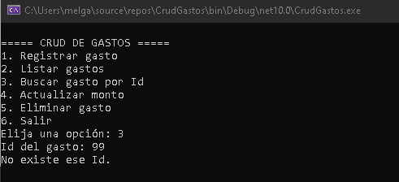
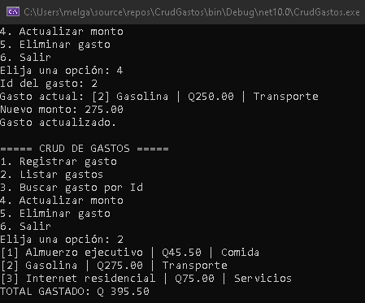
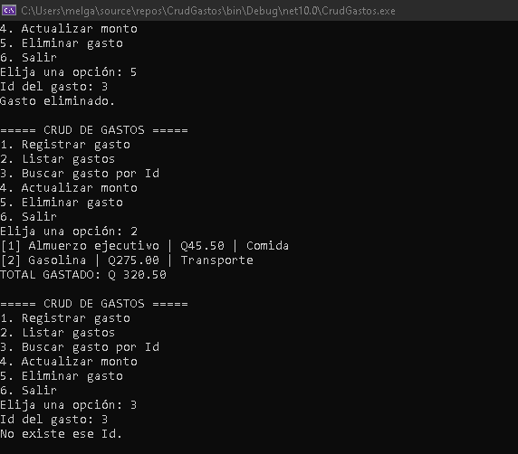
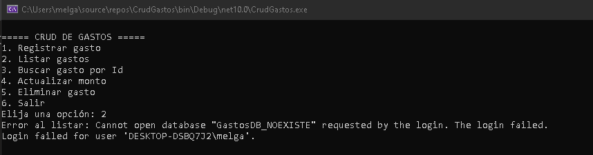

# TAREA 11- Entrega de Videos
## Descripcion

Este repositorio contiene el enlace a la carpeta de Google Drive donde se encentra alojados los videos correspondientes a al **Tarea 11**

## Capturas
### Captura 1-Descripcion:Buscar el gasto con id 2(opcion3)

### Caputra 2-Descripcion:Buscar el id 99(opcion3)

### Captura 3-Descripcion:Actualizar el monto del id 2 a 275.00(opcion4) y listar

### Captura 4-Descripcion:Eliminar el Id 3(Opcion5) y listar; luego eliminar el Id 3 otra vez

### Cambiar GatosDB por un nombre inexistente en la cadena y usar la opcion 2

Los videos pueden consultarse mediante el siguiente enlace:

 **[Ver carpeta de videos en Google Drive](https://drive.google.com/drive/u/1/folders/1ZMZD0ngy7xFngU-Yy45NVsvTBGoXJ-wH)**

